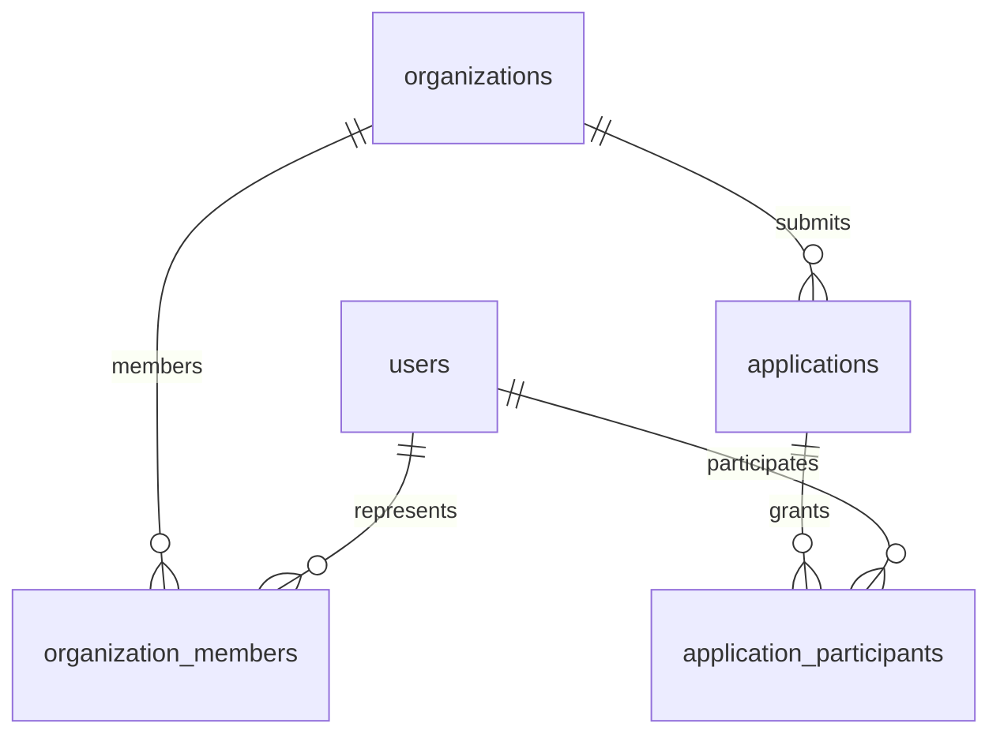
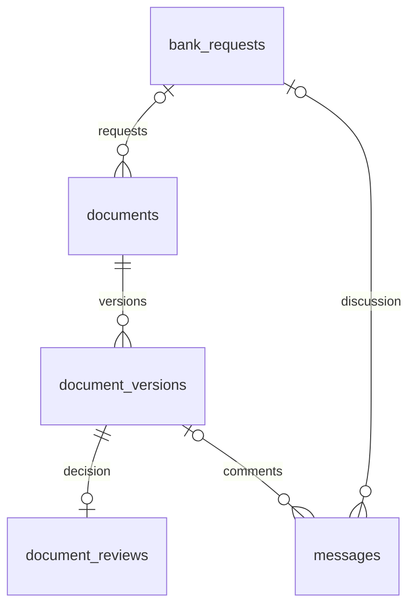

# PostgreSQL: первая структура MVP «Умный кредитный кабинет»

Версия 0.1, 22 октября 2026 года. Схема для одного банка и корпоративных клиентов, включая ИП. Центральная сущность — кредитная заявка с участниками, запросами банка, документами и обсуждениями.

Основание: прочитанный файл `MVP_Stack_Obsidian.md`. В нём зафиксированы Django 5.2, PostgreSQL, версии документов, сообщения, уведомления и аудит; проверка файла отделена от решения сотрудника. Исходный Discovery PDF в этом сеансе прочитать не удалось. Состав полей и статусов ниже — проектное предложение, а не подтверждённые требования из PDF.

## Файлы и запуск

| Файл | Назначение |
|---|---|
| `schema.sql` | Однократное создание отдельной схемы `credit_mvp`: 13 таблиц, индексы, внешние ключи и триггеры |
| `checks.sql` | Проверка сценария с двумя версиями и отрицательные проверки; все демонстрационные записи откатываются |
| `README.md` | Модель данных, границы ответственности и примеры запросов |

Для PostgreSQL 17+ в отдельной базе разработки:

```bash
psql "$DATABASE_URL" -X -v ON_ERROR_STOP=1 -f schema.sql
psql "$DATABASE_URL" -X -v ON_ERROR_STOP=1 -f checks.sql
```

`DATABASE_URL` задаётся локально и не добавляется в репозиторий. Эти команды используют уже существующий сервер; установку PostgreSQL и создание базы пакет не выполняет. Схема создаётся однократно: повторный запуск намеренно завершится ошибкой. Будущие изменения структуры нужно оформлять миграциями.

Проверка в текущем окружении: выполнена статическая сверка объявлений таблиц, связей и содержимого пакета. PostgreSQL/psql отсутствуют, поэтому применение DDL, выполнение триггеров и `checks.sql` здесь не проверены. Это исходный прототип схемы, требующий прогона на PostgreSQL перед интеграцией.

## Таблицы

| Таблица | Что хранит | Основные поля и связи |
|---|---|---|
| `users` | Профили пользователей | UUID, email, имя, активность; вход через Django Auth при интеграции |
| `organizations` | Компании и ИП | Название, уникальный ИНН |
| `organization_members` | Представители клиента | Организация + пользователь, роль, дата отзыва доступа |
| `applications` | Кредитные заявки | Компания, создатель, продукт, сумма, валюта, срок, статус |
| `application_participants` | Доступ к конкретной заявке | Заявка + пользователь; client / manager / analyst |
| `bank_requests` | Структурированные запросы банка | Заявка, автор, текст, срок, статус |
| `documents` | Карточки документов, в том числе ещё не загруженных | Заявка, необязательный запрос банка, тип, обязательность |
| `document_versions` | Каждая загрузка документа | Номер версии, ключ файла, SHA-256, размер, автор, результат сканирования |
| `document_reviews` | Решение сотрудника по версии | Версия, сотрудник, accepted / changes_requested, комментарий |
| `messages` | Переписка | Заявка, автор, текст; необязательный контекст запроса или версии |
| `message_attachments` | Вложения сообщений | Сообщение + конкретная версия документа |
| `audit_events` | История действий | Заявка, актор или система, действие, сущность, JSONB с метаданными |
| `notifications` | Уведомления внутри кабинета | Получатель, событие, заголовок, время прочтения |

Таблица `users` — профиль домена, без паролей. В Django добавляется связь `OneToOneField(settings.AUTH_USER_MODEL, on_delete=PROTECT)`; пароль, сессии, группы и разрешения обслуживает Django Auth. SQL-прототип не реализует вход пользователей.

## Связи





Каждый запрос, документ, версия, сообщение, событие и уведомление относятся к одной заявке. Повторение `application_id` в дочерних таблицах нужно для составных внешних ключей: PostgreSQL проверяет, что связанные объекты находятся в одной заявке. Сообщение может относиться к заявке в целом, к запросу или к версии; одновременно два контекста не допускаются. Вложения при этом задаются отдельно.

## Основной сценарий

1. Представитель компании создаёт `applications`; сервис добавляет его и назначенного сотрудника в `application_participants`.
2. Сотрудник создаёт `bank_requests` и карточки ожидаемых `documents`.
3. Клиент загружает файл. Создаётся `document_versions` со `scan_status = pending`.
4. Worker проверяет файл и записывает `clean`, `infected` либо `error`. При ошибке обработку можно повторить; выдавать файл можно только при `clean` и успешной проверке доступа.
5. Сотрудник оставляет решение в `document_reviews`. Для `changes_requested` обязателен комментарий.
6. Исправленный файл получает следующий `version_number` у того же `documents.id`. Решение и обсуждение старой версии сохраняются.
7. После принятия последней версии каждого обязательного документа сервис может закрыть запрос банка.
8. Бизнес-действие, `audit_events` и связанные `notifications` фиксируются одной транзакцией.

В MVP по версии допускается одно окончательное решение. Повторное рассмотрение после исправления означает новую версию. Если понадобится пересмотр решения без нового файла, потребуется отдельная модель истории решений. Успешный или заражённый результат сканирования в этой версии схемы окончателен; для повторных сканирований понадобится таблица запусков проверок.

Статус документа вычисляется по последней версии: `missing`, `scanning`, `scan_error`, `blocked`, `awaiting_review`, `accepted`, `changes_requested`. Отдельная изменяемая колонка `documents.status` не создаётся, чтобы не расходиться с версиями и решениями.

## Что проверяет PostgreSQL

- Первичные ключи — UUID; сумма — `numeric(18,2)`; время — `timestamptz`.
- Сумма и размер файла положительны; номер версии уникален внутри документа.
- Создатель заявки связан с её организацией; автор загрузки или сообщения состоит в участниках заявки. Внешние ключи сохраняют связь и после отзыва доступа.
- Составные FK запрещают привязать документ к запросу, вложение к сообщению или уведомление к событию другой заявки.
- Триггер разрешает решение только по `clean`-версии и от активного участника с ролью manager / analyst.
- Метаданные загруженной версии неизменяемы; результат решения, аудит и версии защищены от обычного удаления, история решений и аудит также от изменения.
- В одной заявке максимум один действующий manager. Уведомление по событию не дублируется одному получателю.

Уникальность ИНН и его длина проверяются БД; контрольные цифры и существование организации проверяет сервис. Значение валюты проверяется на формат из трёх заглавных букв, а допустимый список валют задаёт приложение.

## Что проверяет Django

FK подтверждает наличие участника, но не заменяет авторизацию. Сервис проверяет текущую активность пользователя, отозванные членства и права на действие. В частности: клиент должен быть активным представителем компании заявки, назначение банковских ролей разрешается только сотрудникам, создать запрос банка может только сотрудник. Нельзя доверять `author_id`, `uploaded_by` или `reviewed_by` из запроса браузера — их берут из серверной сессии.

Переходы статусов заявки/запроса, полноту комплекта, MIME-тип и фактическое содержимое файла, размер загрузки и право на скачивание также проверяет backend. Срок `due_at` не превращает запись в новый статус автоматически: просрочка вычисляется запросом.

Доступ к БД есть у backend и worker; браузер работает через API. RLS и раздельные эксплуатационные роли БД в этом прототипе не настроены. Для аудита приложение явно добавляет события: триггеры блокируют изменение существующей истории, но не обеспечивают полноту регистрации действий и не защищают от владельца БД.

## Транзакции и конкурентные изменения

Номер новой версии выделяется после блокировки строки документа, а не чтением `MAX` без блокировки:

```sql
BEGIN;
SELECT id FROM credit_mvp.documents
WHERE id = :document_id FOR UPDATE;

SELECT COALESCE(MAX(version_number), 0) + 1 AS next_number
FROM credit_mvp.document_versions WHERE document_id = :document_id;

-- INSERT document_versions с полученным номером;
-- INSERT audit_events и notifications;
COMMIT;
```

Это шаблон с параметрами `:document_id`; backend должен выполнять все шаги в одном соединении и одной транзакции (`transaction.atomic`, `select_for_update`). Блокировка по документу сериализует загрузки, а UNIQUE остаётся последней защитой от дубля номера.

Файл записывается под новым серверным ключом в закрытое хранилище и не перезаписывается. Файловое хранилище не участвует в транзакции PostgreSQL: при откате нужна очистка осиротевших файлов. Worker запускается после commit. Периодическая задача подбирает оставшиеся `pending`/`error`-версии с учётом задержки повторов, чтобы сбой отправки в очередь не оставил документ навсегда непроверенным.

При закрытии запроса сервис блокирует родительский запрос и его документы и повторно проверяет последние версии. Добавление карточек и новых версий должно соблюдать тот же порядок блокировок, иначе проверка полноты может устареть. Решение «accepted» по старой версии не означает принятие новой.

## Пример: список документов и их текущих состояний

Параметр `:application_id` передаётся backend как bind parameter; пример не предназначен для прямой вставки в psql без подстановки.

```sql
SELECT d.id, d.title, d.is_required,
       v.id AS latest_version_id, v.version_number,
       CASE
         WHEN v.id IS NULL THEN 'missing'
         WHEN v.scan_status = 'pending' THEN 'scanning'
         WHEN v.scan_status = 'error' THEN 'scan_error'
         WHEN v.scan_status = 'infected' THEN 'blocked'
         WHEN r.id IS NULL THEN 'awaiting_review'
         ELSE r.decision
       END AS document_status,
       r.comment
FROM credit_mvp.documents d
LEFT JOIN LATERAL (
    SELECT v.* FROM credit_mvp.document_versions v
    WHERE v.document_id = d.id
    ORDER BY v.version_number DESC LIMIT 1
) v ON true
LEFT JOIN credit_mvp.document_reviews r ON r.document_version_id = v.id
WHERE d.application_id = :application_id
ORDER BY d.created_at, d.id;
```

История переписки сортируется по `(created_at, id)`, а не только по UUID. Для MVP polling каждые 2–3 секунды повторно получает сообщения открытой заявки с учётом пагинации. Курсор по времени создания подходит для просмотра истории, но сам по себе не гарантирует получение всех новых сообщений: параллельная транзакция может зафиксироваться позже с более ранним `created_at`. Для надёжного инкрементального потока понадобится отдельное решение с учётом порядка фиксации событий.

## Интеграция с согласованным стеком

В рабочем Django-проекте источником структуры должны стать модели и миграции. Этот SQL нужен для отдельного прототипа и проверки проектирования. Не следует одновременно применять его вручную и создавать те же таблицы обычными Django-миграциями.

При переносе: создать приложения accounts, organizations, applications, documents, communication; добавить связь профиля с Django Auth; перенести CHECK/UNIQUE в модели; составные FK и триггеры оформить отдельной SQL-миграцией с корректным обратным SQL. В Django 5.2 обычный `ForeignKey` не описывает показанные составные связи сам по себе. Представление составных PK таблиц-связок в ORM нужно выбрать отдельно: суррогатный `id` + уникальная пара или поддерживаемый `CompositePrimaryKey` с учётом ограничений его связей.

Не включены: счета, платежи, кредитный скоринг, кредитные договоры, ковенанты и реальные банковские интеграции. Их добавляют при подтверждении соответствующих сценариев. Внешние источники в текущем MVP представлены моками.

## Документация

- [PostgreSQL 17: ограничения и внешние ключи](https://www.postgresql.org/docs/17/ddl-constraints.html)
- [PostgreSQL 17: блокировки строк](https://www.postgresql.org/docs/17/explicit-locking.html)
- [Django 5.2: миграции](https://docs.djangoproject.com/en/5.2/topics/migrations/)
- [Django 5.2: транзакции](https://docs.djangoproject.com/en/5.2/topics/db/transactions/)
- [Django 5.2: составные первичные ключи](https://docs.djangoproject.com/en/5.2/topics/composite-primary-key/)
